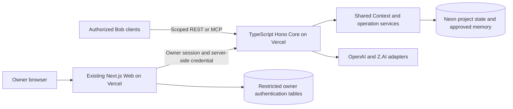
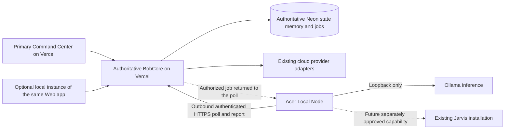

# BobCore Hybrid Phase 0 — architecture and foundation

Date: 2026-10-26 (America/Toronto). Project: `bobai`, repository `boisey9/BobAI`.

Status: **architecture documented; hybrid runtime not implemented or accepted**. The owner approved this documentation milestone and its direction. Proposed interfaces and future changes below are not activated BobCore decisions, granted permissions, or authorization to deploy.

Local review branch: `codex/bobcore-hybrid-phase-0`, based on `36552fc430b06b91ee1e47acef124e4ea36987c0`. This milestone changes this document and [the implementation index](../../implementation.md) only. No PR is published. No merge, deployment, migration, credential change, Production write, port exposure, model/provider switch, Jarvis modification, or production-data move is part of this work.

## 1. Objective and fixed boundaries

Evolve the existing system into one Bob identity with cloud reasoning and securely delegated local computation. BobCore remains the authoritative coordinator for identity, permissions, shared context, approved memory, project state, routing, and orchestration. Neon remains the authoritative database; Production and testing remain isolated.

**Vercel is the primary Command Center host.** Extend the existing `Web/` application. The same application may later run locally on the Acer; this is an alternative hosting configuration, not a separate dashboard or memory authority. The Acer EndeavourOS laptop becomes the local compute node, initially providing Ollama inference and operational health. Local execution through Jarvis is a subsequent capability with separate permissions and acceptance.

The first hybrid acceptance milestone is **an authenticated Acer heartbeat followed by one successful Ollama inference routed through BobCore**. Manual routing comes first. Jarvis execution, automatic routing, advanced dashboard features, voice, and genuinely local-only content processing are later milestones.

Owner-selected defaults:

- Live Core authorization is required. The initial node does not provide independently authorized offline reasoning.
- Recoverable hosted jobs may retain encrypted request/result content for a one-hour operational window, separate from approved memory and audit records.
- Preserve the existing active cloud provider and supported adapters.
- Prepare documentation on a local feature branch without publishing a PR. Git deployment settings remain unchanged.

## 2. Evidence ledger and preflight

Evidence classes are deliberately separate: repository implementation, a saved release package, fresh metadata observations, dated operational acceptance, and proposed design. Historical test counts do not prove current runtime acceptance.

### Project context and connection limitation

The [project manifest](../../.bob/project.yml), [AGENTS.md](../../AGENTS.md), and [project](../standards/bob-project-standard-v1.md), [interface](../standards/bob-interface-standard-v1.md), and [activity](../standards/bob-activity-standard-v1.md) standards were inspected. The explicit owner request and repository both identify `bobai` / `boisey9/BobAI`.

The implementation preflight called `bob_get_context` for `projectKey=bobai`, `surface=codex`, with this documentation objective. Its response was:

| Field | Observed value |
| --- | --- |
| Authority | `bob-core`, version `0.2` |
| Project | key `bobai`, name **BobAI staging**, repository `null`; updated `2026-09-20T15:06:31.161Z` |
| Returned surface | `chatgpt`, despite requesting `codex` |
| Generated | `2026-10-26T15:43:48.111Z` |
| Revision | `abac42c4eb49d68268940130abb334f81edfcdf7aa867be521f247441a700723` |
| Source checks | All five sources available, checked `2026-10-26T15:43:47.913Z` |
| Latest changes | Decisions/memories: September 7; tasks/events: October 6; no handoffs |
| Completeness | Events truncated; overall `partial=true` |

This is not a verified Production BobAI/Codex connection. Staging records are not relabeled as Production, and no unrelated project content is copied here. Production task IDs, expected task versions, and current owner decisions cannot be established through this connection. No checkpoint is uploaded through it; section 12 retains a pending checkpoint.

Owner correction on October 26: **BobCore Staging is retired and must not be used for this work. Use BobCore.** The response above is historical diagnostic evidence only. A read-only native configuration check found `bob-core` at the Production `/mcp/sync` endpoint and `bobcore_bobai` at `/mcp/linked`; neither is exposed as a callable Production tool in this chat. Configuration alone does not verify project binding or a successful context read. Continue local work from verified source evidence; do not fall back to Staging or change credentials.

### Source and operational evidence

| Evidence | Finding | Limit |
| --- | --- | --- |
| GitHub `main`, refreshed October 26 | `36552fc430b06b91ee1e47acef124e4ea36987c0`; repository tree complete; no open PRs returned during preflight, and no hybrid branch identified | Branch/PR inventory must be refreshed before later work |
| Local checkout | Fetched from `https://github.com/boisey9/BobAI.git`; `origin/main` matches the verified SHA; feature branch created without changing another checkout | The starting directory was an unborn repository, not an implementation baseline |
| October 23 saved runtime package | All 110 runtime files match the package's SHA-256 manifest; compared with immutable GitHub blobs and then the fetched checkout | A package manifest proves saved bytes, not an independent download of every deployed byte |
| October 26 alias reads | Core canonical alias points to `dpl_CXiipZGjjegHiBNvoqzmHzeTvjLk`; Web to `dpl_CAkTAgNhXyySzQcqYqSxqt2Ny7PM`; these match the October 23 release record | Alias identity is separate from authenticated functional acceptance |
| October 23/24 activation record | Reports applied migrations 004/007/008, restricted Web role, accepted owner passkey login, task persistence, and chat | Dated recorded acceptance; these workflows were not repeated for this documentation change |
| Latest reviewed access status | Commissioning password login remains enabled on the canonical Web snapshot; a password-disabled candidate is READY but unpromoted; Production Codex/ChatGPT acceptance remains unfinished | A project-variable change or installed client config does not establish runtime retirement or a working client |
| October 26 Neon metadata | Production `br-rapid-hall-aykwycjn`; staging `br-green-resonance-ayvz8l7o`; six-hour restore window; Production `protected=false` | Separate branches do not alone prove every client's correct binding |
| October 26 backup checks | Production `bob_backup_runs` query returned zero rows; inspected recent scheduled backup runs were skipped | Does not establish that no historical manual artifact exists; does establish a recurring-recovery evidence gap |
| October 26 Vercel Git settings | Both projects have Git deployments enabled and affected-project skipping enabled; the proposed branch lacks an explicit deployment block | Do not assume a documentation push guarantees zero deployment; keep this branch local |

Local operator evidence is outside Git and remains on the owner's machine. The repository-safe findings above are recorded here; no private deployment payloads, configuration values, or raw database exports are copied into the repository. Future implementers must obtain these artifacts through authorized access and recheck their hashes:

- [Activation overview](/Users/erikboisvert/Documents/Codex/2026-10-18/task/bobcore-production-activation-20261023/OVERVIEW.md) and [dated status](/Users/erikboisvert/Documents/Codex/2026-10-18/task/bobcore-production-activation-20261023/evidence/LIVE-STATUS.json).
- [Runtime manifest](/Users/erikboisvert/Documents/Codex/2026-10-18/task/bobcore-production-activation-20261023/prepared-release/MANIFEST.json), whose source paths are relative to `prepared-release/`.
- Migration copies at `bobcore-production-activation-20261023/Core/migrations/008_oauth_checkpoint_scope.sql` and `bobcore-production-connections-20261023/candidate/Core/migrations/008_oauth_checkpoint_scope.sql`, under the same local task parent.
- [Inspected scheduled backup run](https://github.com/boisey9/BobAI/actions/runs/40338533453).

## 3. Verified current architecture and reusable implementation



| Subsystem and reviewed sources | Reuse | Gap or qualification |
| --- | --- | --- |
| [Core app](../../Core/src/app.ts), [runtime](../../Core/src/runtime.ts), [provider interface](../../Core/src/ai/provider.ts), [factory](../../Core/src/ai/provider-factory.ts), [OpenAI](../../Core/src/ai/openai-provider.ts), [Z.AI](../../Core/src/ai/zai-provider.ts) | Existing provider abstraction, bounded retries/abort/error handling, server-injected Bob context | Configuration selects the provider; no validated per-request local router or asynchronous inference queue. Saved deployed provider/error behavior differs from GitHub |
| [Shared Context](../../Core/src/context/service.ts), [Neon store](../../Core/src/context/neon-store.ts), [operations](../../Core/src/context/operations.ts) | Owner/project/privacy filtering before ranking; approved baseline memories; active decisions; revisions, timestamps and partial-source indicators | Preserve bounded context semantics across models; never turn an unavailable source into a successful empty result |
| Same context operation services | Stable task IDs/versions; transactional audit and operation receipts; payload-conflict rejection | Reuse these patterns for jobs; task receipts are not themselves a worker queue |
| [Interface credentials](../../Core/src/security/interface-credential.ts), [OAuth](../../Core/src/security/oauth.ts), [MCP](../../Core/MCP.md), [Codex configuration](../../.codex/config.toml) | Server-derived project/surface/scopes, owner-only Web exception, revocation and request limits | A worker needs a distinct least-privilege principal. Old configuration is not proof of current Production Codex access |
| [Web](../../Web/README.md), [Control Center](../../Web/components/control-center-v2.tsx), [Core client](../../Web/lib/bob-core.ts), [owner authentication](../../Web/lib/owner-auth.ts) | Existing owner session, CSRF boundary, project selection, tasks/activity/approval/context surfaces | Reconcile the deployed task/Today/project/import enhancements before extending this UI |
| [Governed workflow](../../Core/src/workflow), [architecture](../architecture.md), [release gates](../release-gates.md) | Existing separately gated workflow and evidence concepts | Do not replace or activate them as a shortcut to worker execution. Planned reminder jobs/outbox are not an implemented inference queue |
| [Recovery](../recovery.md), [backup script](../../Core/scripts/backup-database.mjs), [restore script](../../Core/scripts/restore-database.mjs), [backup workflow](../../.github/workflows/backups.yml) | Snapshot-consistent encrypted exports, manifest/inventory checks, isolated restoration and credential cleanup | Operational activation and complete recovery acceptance remain open |

Current conversation history is client-held and cleared on workspace changes; a durable conversation archive is not established by the existing chat API. No Ollama adapter, Acer worker, worker enrollment, capability registry, inference leases, or Jarvis bridge was found in the reviewed repository/runtime source. Acer hardware and installed software were not accessed.

## 4. Production/GitHub reconciliation comes first

Compare the release manifest's 110 runtime entries against GitHub blob hashes at the pinned commit; verify each local file against its manifest SHA-256 first. The same comparison against the fetched checkout produced:

| Payload | Identical | Modified | Additional to GitHub | Total |
| --- | ---: | ---: | ---: | ---: |
| Core | 26 | 18 | 2 | 46 |
| Web | 26 | 20 | 18 | 64 |
| **Total** | **52** | **38** | **20** | **110** |

Thus **58 runtime files differ or are absent**. This is a payload comparison, not a whole-repository diff. Tests, migration history, documentation, and source excluded from a deployment payload remain relevant.

Both saved copies of `008_oauth_checkpoint_scope.sql` are identical; SHA-256 is `46836d03e0225daec29896b535f47689cf71f5483f224664116b04a45906717e`. The file is absent from the pinned GitHub tree. The reviewed migration extends the permitted OAuth scope vocabulary with `handoffs:write`; it does not grant the scope to existing clients. Its applied-state evidence is the October 23/24 activation record, not a migration run performed here. Do not blindly rerun it: its guarded precondition expects the older constraint.

Selective reconciliation is required in both directions:

- GitHub contains 24 files under `Core/src/workflow/` outside this saved runtime payload. Its runtime mounts the disabled governed workflow; the saved runtime instead adds project creation. Preserve the appropriate integration and feature gates from both.
- Saved MCP source adds the project UUID, scope-gated `bob_record_handoff`, and approval-required task error handling. Saved OAuth source adds `handoffs:write` to its accepted vocabulary. Reconcile these as a bounded authorization/continuity change.
- Deployed provider timeout/error behavior, owner-auth privacy fixes, and Web task/project/import UI need their own behavior-specific reviews. Do not infer that every textual difference is a defect.
- Lockfiles, install commands, and deployment configs are part of the reconciliation inventory. They must not be copied wholesale; GitHub's Web installation currently includes shared Core dependencies for governed workflows.

### Exact first implementation task

**Reconcile deployed Core project identity and checkpoint authorization with GitHub**, on a later local branch `codex/reconcile-core-context-checkpoints`.

Starting from freshly verified main, review the deployed project UUID response, checkpoint tool registration, explicit `handoffs:write` authorization, associated types/credential checks, and exact migration 008 source. Port only the reviewed changes and their necessary compatibility fixes. Add source provenance and dated applied-state evidence; do not apply the migration, activate access, change flags, or overwrite the runtime tree.

Acceptance: project/surface isolation, minimum required scopes, checkpoint identical retry/readback, conflicting operation rejection, no decision activation, and preservation of existing disabled governed-workflow integration. Use existing Core checks and isolated synthetic protocol/database tests where separately authorized. Do not claim hosted acceptance from local tests.

## 5. Target architecture and privacy modes



The dashed Core-to-node edge is a response on a connection initiated by the node, not an inbound connection to the Acer. No public Ollama or local-execution port is needed. Keep Production and testing endpoints, database branches, credentials, device grants, and job instance identities distinct. Personal external access is not granted by this BobAI design.

| Mode | Content path and truthful claim |
| --- | --- |
| Hosted hybrid inference — first milestone | Browser/client → hosted Core → encrypted operational queue → Acer/Ollama → hosted Core → client. Core handles request/result content. Local model execution does **not** make the overall processing local-only |
| Same Web application hosted locally — optional later configuration | The UI/server runs locally but uses hosted Core. Content still crosses the hosted boundary; this remains hosted hybrid processing |
| Genuinely local-only content processing — subsequent design | Prompts, files, outputs, and content-bearing telemetry stay on the Acer. It requires a separate local content path that does not relay them through Vercel, Neon, or a cloud model. Any cloud authorization or non-content metadata exchange is disclosed independently |

The first milestone does not provide offline independence, local-only residency, or a new local memory authority. A later local-content mode must preserve Core approval/authorization semantics without quietly caching a second authoritative memory store. Its content transport and permission model need their own acceptance; they are not implemented by merely running `Web/` locally.

Optional local Web uses the same codebase with an explicitly approved local origin and scoped authentication configuration. Do not copy the privileged hosted Web credential, database credentials, cloud keys, or unrestricted owner access onto the Acer. Local hosting/authentication setup is separate future work.

## 6. Acer node, authorization, and proposed interfaces

Introduce a small TypeScript worker in a future `LocalNode/` package, reusing the repository's language/tooling conventions. Run it under a restricted systemd account. Initially allow one inference at a time and expose only inference/health capabilities. It must not receive shell, filesystem, browser, package-installation, or Jarvis execution tools. Model downloads and updates require separate owner action.

### Device authorization and communication

1. The node requests a short-lived, one-use enrollment challenge over outbound HTTPS. An authenticated owner approves the exact device, BobAI project UUID, environment/instance, and requested capabilities in existing Web.
2. Issue a separately revocable worker credential using Core's credential/revocation conventions. Store only its hash and safe binding metadata in Core; keep the secret in a restricted OS credential facility on the Acer. Never reuse an owner-wide Web, primary device, cloud provider, or general MCP credential.
3. Derive project, environment, principal, and scopes on the server. Caller-supplied headers or project names cannot widen access. Require authorization again at heartbeat, claim, lease renewal, and completion.
4. Restrict the worker to fixed authorized Core origins with TLS verification; reject redirects carrying credentials. Production and staging enrollment are independent. A restored Core instance has a new instance/grant generation, invalidating copied device authority.
5. Use bounded payloads, request deadlines, per-device rate limits, and exponential backoff with jitter. Never log secrets, raw prompts/results, private reasoning, or sensitive context. Revocation blocks new claims and invalidates active leases; it cannot erase content already seen by a compromised device.

Ollama stays on loopback. Verify its installed version and local-only configuration before acceptance; do not assume an installed model cannot invoke a cloud service. The [Ollama FAQ](https://docs.ollama.com/faq) documents loopback binding and cloud-disable controls. No Ollama or Jarvis service is changed in Phase 0.

### Proposed interface families

These names are architecture proposals, not currently available endpoints or scopes.

| Boundary | Operations and minimum data |
| --- | --- |
| Owner `/v1/local-nodes` | Enrollment approval, device inspection, capability grant, revocation; owner-authenticated and CSRF-protected through existing Web |
| Worker `/v1/local-nodes` | Enrollment exchange, heartbeat/capabilities, claim, renew, complete/fail; scopes limited to worker health and its authorized inference jobs |
| Client `/v1/inference-runs` | Create, status, cancel, acknowledge; stable `operationId`, project, explicit route/model selection, bounded request, expected version for conflicting updates |
| Core run envelope | Run ID, immutable project/instance identity, captured context revision, policy version, selected node/model capability, deadline and payload expiry |
| Attempt envelope | Attempt ID, lease expiry, fencing token, grant generation, result/error classification, actual model/digest and safe usage/timing metadata |
| Existing `/v1/chat` | Remains compatible and preserves configured cloud behavior while new asynchronous local runs are introduced |

Health reports contain operational CPU/RAM/GPU capacity, uptime, worker/Ollama versions, installed-model identifiers/digests, and job state. Do not collect process names, file paths, screens, browsing history, or content-bearing diagnostics. Hardware capabilities are advisory; Core policy authorizes the allowed model/capability.

## 7. Routing, continuity, and durable execution

### One Bob identity across inference engines

Core builds the Bob prompt and the same approved Shared Context rules for every route. Record context revision, source freshness/completeness, policy version, route, and actual model. Approved memories and active decisions remain Core-owned; proposed decisions stay proposals. Model outputs cannot directly mutate authoritative memory, approve decisions, or become execution instructions.

Manual selection initially offers the configured cloud route or an approved installed Ollama model. Preserve existing cloud adapter behavior and active configuration. Do not silently switch a local request to cloud or select/download another local model. A model that cannot fit the required bounded context fails explicitly rather than dropping active decisions. Reject unavailable identity/authorization or required approved-context sources; surface ordinary source truncation according to existing context rules.

Capture context once per run. Recheck permissions and relevant decision/policy validity before dispatch; an invalidated run requires a refreshed request. Preserve the captured revision in the result. Do not invalidate a run merely because its own operational event changed the overall context revision. Test context inputs and authority consistently across routes; different models are not expected to produce identical wording.

### Durable job model

Neon owns run/attempt/lease metadata and operation receipts. Vercel receives short enqueue, status, claim, renewal, and completion requests; no long-lived function or in-process queue owns a job. The worker performs inference. This avoids coupling local inference to [Vercel function duration](https://vercel.com/docs/functions/limitations).

Use `queued`, `running`, `succeeded`, `failed`, `cancelled`, and `expired` run states, plus attempt/lease records. Enqueue and terminal completion commit the state, safe audit record, and operation receipt transactionally. Normalize/fingerprint inputs; identical retries replay the saved response, while changed input under the same operation ID conflicts. Authorize every replay.

Claim atomically, increment a fencing token, and attach the attempt to the exact device grant. Completion must match the current attempt, fence, lease, project/instance, deadline, and live permission. Only one attempt can commit a terminal outcome. Retryable computation may run more than once; this is not a promise of exactly-once physical execution.

Proposed initial test defaults: one in-flight inference per node; 90-second leases renewed every 30 seconds; heartbeat considered stale after 90 seconds; a ten-minute run deadline; at most three attempts for explicitly retryable inference failures. Idle polling is bounded and backoff respects server limits. Validate these defaults against the Acer before activation; no scheduler or recurring workload is enabled here.

| Failure | Required behavior |
| --- | --- |
| Acer sleeps, disconnects, or loses Core | No new work; renewal failure cannot extend authorization. Abort by lease expiry, then reconcile with Core before another attempt |
| Worker crashes before completion | Lease expires; Core can authorize a bounded replacement attempt, subject to deadline/content expiry |
| Completion commits but its acknowledgement is lost | Retry the identical operation; read the existing receipt and result without creating another outcome |
| Old worker reports after reassignment | Reject its stale fencing token; it cannot overwrite the accepted result |
| Cancellation, revocation, or policy denial | Atomically prevent later acceptance, request cooperative abort, and discard late results; do not fall back to cloud |
| Ollama unavailable, incompatible, out of memory, or timed out | Return a classified failure with safe diagnostics; bounded transient retries only |
| Core/Neon unavailable | Do not claim success or accept unaudited local state as authoritative; retry metadata operations safely after reconnection |
| Restore of an older database | Revoke copied worker grants, change instance/grant generation, clear transient content, and quarantine unfinished runs before any worker connects |

### One-hour operational content buffer

Store request/context/result content separately from memory and audit metadata, encrypted with authenticated encryption and keys held outside database dumps. Apply project/run authorization to every read and never expose decrypted queue content through activity or status endpoints. Keep worker copies in memory and discard them on completion/abort; do not add a local conversation archive.

Expiry is fixed at one hour from creation, not extended by retries. Enforce access denial at expiry even if cleanup is delayed. Remove content after client acknowledgement or expiry cleanup, and monitor cleanup failures. After content expires, a new owner request is required; the run metadata can retain a safe failure classification.

This is **logical operational retention**, not a claim of immediate physical erasure. Encrypted copies may remain in Neon recovery history. Future exported-backup inventory rules must explicitly exclude transient content data while preserving the schema and consistent verification policy; restored environments must purge it before use. Key custody/rotation and cleanup acceptance are prerequisites for enabling this queue. Do not put raw content or content-bearing error text into receipts intended for general audit access.

The Ollama adapter initially uses bounded, non-streaming [chat requests](https://docs.ollama.com/api/chat), sends Core-assembled messages, returns only the answer and allowed operational metadata, and ignores any proposed tool calls/private reasoning fields. Streaming and tool execution are separate capabilities.

## 8. Backup and restoration readiness gate

**A verified backup and complete restoration are prerequisites before risky changes**, including Production schema/access changes, deployment cutovers, or operations that could compromise existing state. Read-only investigation, local source reconciliation, and documentation can proceed without activating those operations. Readiness evidence does not itself authorize a migration or release.

The October 26 preflight verified Neon project `noisy-boat-43840462`, PostgreSQL 18, Production branch `br-rapid-hall-aykwycjn`, and its exact compute before the bounded backup-ledger SELECT. The restore window was `21600` seconds (six hours); Production was not marked protected. Testing branch `br-green-resonance-ayvz8l7o` was separate. No database content or credentials were exported.

Implemented recovery assets include a consistent snapshot shared by inventory and `pg_dump`, streamed age encryption, an encrypted manifest, private storage upload/readback, and restoration into an empty isolated database with integrity/relationship checks and credential cleanup. The existing runbook targets a **24-hour RPO and two-hour complete RTO**. Those are unproven operational targets, not measurements from this milestone.

Open requirements:

- A fresh, verified backup artifact and observed successful scheduled execution, with retention/failure monitoring. The empty ledger and skipped runs do not close this requirement.
- A restore from the downloaded artifact into an isolated destination, including counts/relationships, approved-context isolation, task receipt replay/conflict/version behavior, and owner login/revocation.
- Confirmed offline recovery-key custody and restricted backup access. Storage in the same provider/account does not alone demonstrate recovery after losing that account.
- Measured data loss and end-to-end restoration time, including access recovery and application acceptance, against the RPO/RTO targets.
- Updated restoration handling for worker credentials, instance identities, pending jobs, leases, and transient content before these schemas ship. Never automatically replay future Jarvis actions after restoration.
- Explicit effective-privilege review for every new table. The October 23 auth rollout required correcting inherited Core/backup privileges on newly created auth tables; unchanged defaults must not silently grant worker/auth access. Backup coverage and permissions must be revalidated after such corrections.

Branch protection, restore-window changes, backup activation, role changes, and drills that create/migrate databases require separately scoped execution. Nothing here enables them. Consult the existing [recovery runbook](../recovery.md) and [Neon branch restoration documentation](https://neon.com/docs/postgres/backup-restore/branch-restore); a finite restore window does not replace an independently verified backup.

## 9. Command Center integration and implementation slices

Extend existing Web navigation and components after reconciling its deployed source. The initial addition is a modest node/run view: device authorization state, heartbeat freshness, installed approved models, explicit route selection, run progress, cancellation, and classified failures. Display environment and observation time. Use bounded polling initially and expose stale/unavailable states; do not imply continuous live monitoring when observations are delayed.

Keep memory, decisions, tasks, and approvals in their existing authoritative surfaces. Long-term conversations, voice, agents, richer model management, and a futuristic dashboard are product milestones after the first proven hybrid flow. A new visual shell is not a prerequisite for secure inference.

Each row is a separate reviewable change with its own acceptance. Later implementation, test-infrastructure mutation, deployment, and activation require their own authorized scope.

| Order | Small implementation slice | Independent acceptance |
| --- | --- | --- |
| 1 | Core identity/checkpoint reconciliation, as specified in section 4 | Project UUID and scope checks; identical retry/readback; conflict rejection; existing feature-gate compatibility |
| 2 | Core provider/runtime source reconciliation | Existing provider behavior, timeout/abort handling, private errors, and governed/runtime integration preserved |
| 3 | Web authentication source reconciliation | Owner login/session/CSRF/revocation and project consent; private error handling; no automatic activation |
| 4 | Web task/context interface source reconciliation | Existing task/Today/project/import behavior and project isolation; preserve accepted chat/task flow |
| 5 | Disabled hybrid contracts and explicit routing policy | Fake-adapter contract tests, legacy chat compatibility, local selection cannot silently reach cloud |
| 6 | Device enrollment, revocation, and heartbeat; telemetry-only node | Authorized heartbeat plus wrong-project/environment/replay/revocation denials and stale status |
| 7 | Durable runs/leases/receipts, encrypted content and cleanup | Real isolated transaction/concurrency tests, crash recovery, stale-fence rejection, cancellation and expiry |
| 8 | Loopback Ollama adapter and minimal run integration | First authenticated heartbeat → Core-routed synthetic inference → committed result → retry/readback acceptance |
| 9 | Minimal existing-Web hybrid controls | Owner browser flow, honest progress/error/offline states, cancellation and accessibility |

Recovery readiness is a prerequisite for risky activation across these slices, not a final cleanup task after release. Repository CI uses Node 24; future code changes use the existing Core/Web checks plus relevant isolated protocol/transaction tests. Phase 0 does not install application dependencies or claim those checks were rerun.

## 10. First hybrid acceptance milestone and subsequent gates

Start with synthetic content in an explicitly verified testing environment. A connected staging tool that returns the wrong surface or uncertain identity is not sufficient environment verification. Production acceptance follows a separate release approval and verified recovery readiness.

The first milestone passes only when all of these are evidenced together:

1. The owner approves an Acer device bound to the correct BobAI project UUID, test instance/environment, and inference/health capabilities. A heartbeat reaches Core and returns a receipt; stale/offline detection is demonstrated.
2. Core accepts a stable operation ID for one synthetic request explicitly selecting an approved, installed Ollama model. Required approved-context rules and the captured context revision are present; no production/private content is used.
3. The authorized node claims the run, maintains a valid lease, invokes only loopback Ollama, and returns an answer with the run/attempt identity and actual model/digest.
4. Core commits one result and safe audit outcome. The client reads and acknowledges it. Identical retry/readback returns the existing outcome; a conflicting payload is rejected.
5. Wrong-project, wrong-environment, revoked-device, forged-header, and stale-lease attempts fail. Cancellation, restart/disconnection, output loss, and expiry cannot create a second committed outcome or authorize new work.
6. Verify no cloud fallback, publicly reachable Ollama, credential disclosure, raw content in activity logs, local execution tools, or Jarvis changes. Verify the buffer expires and cleanup works.

Report build, runtime, and functional acceptance separately. An authenticated heartbeat alone proves connectivity, not inference or continuity. One successful inference proves the first integration path, not production reliability, model quality parity, offline autonomy, or safe computer execution.

Later gates: sustained reliability/cost and capacity measurements; controlled Production acceptance; optional local Web hosting; explicit local-content-only privacy design; automatic routing evaluated against approved privacy/quality/cost policy; Jarvis capability-specific approval, sandboxing, audit and uncertain-outcome recovery; advanced dashboard, voice, and agent orchestration. Model-generated tool requests do not grant any of these permissions.

## 11. Risks, dependencies, and Phase 0 validation

| Risk or dependency | Required next evidence/action |
| --- | --- |
| GitHub/deployment divergence | Selective source reconciliation, immutable provenance, and compatibility tests; preserve code present only in either version |
| Missing migration source / uncertain future schema baseline | Add reviewed migration source and applied-state provenance; inspect the actual target before any later migration, never infer from filename alone |
| Production Codex context unavailable | Complete the supported owner OAuth connection separately; verify project UUID/key, environment, trusted surface, revision, timestamps, completeness, checkpoint retry/readback and revocation |
| Commissioning access remains in latest release record | Complete separately approved password retirement and acceptance; do not repeat bootstrap or treat a variable edit as a runtime change |
| Backup/restore and inherited database grants | Close section 8's recovery gate and inspect effective role permissions before risky work |
| Acer capabilities unknown | Read-only inventory of CPU/RAM/GPU/VRAM, drivers, disk, Ollama/model versions, service account, suspend behavior and existing Jarvis boundaries before selecting models or installation changes |
| Laptop availability and compromised worker | Leases/fencing, explicit stale status, least privilege, short-lived content exposure, revocation; no claim that a remote coordinator can erase already disclosed content |
| Cost and resource contention | Measure polling, database wakeups, model latency/memory, cloud usage and storage. Existing request limits are not monetary budget enforcement; do not enable automatic routing or recurring workload based on an unenforced budget |
| Optional local Web and local-only privacy | Review origin/authentication and scoped credentials; separately prove the content path before claiming local-only processing |

Phase 0 validation is limited to the two documentation files: exact path scope, whitespace/error checks, link target and Mermaid review, source-comparison arithmetic/provenance, and coverage of the approved requirements. No runtime build, inference, database restoration, deployment acceptance, or synchronization is claimed by documentation checks. Historical test evidence remains dated.

The diff must show only this new file and `implementation.md`; runtime, configuration, migration, credentials, and deployment files must remain identical to the base. Local Git checkout/branch preparation is not a remote publication. Keep the branch local because the existing Git integration does not explicitly prohibit deployments for its name.

Validation performed on October 26: `git diff --check` passed; the diff contains exactly the two approved Markdown paths. Both files parsed successfully as GitHub-flavored Markdown. All 52 local link occurrences resolve, including the owner-local evidence links; external links were checked for syntax, not newly exercised as runtime endpoints. Both Mermaid blocks passed structural checks and manual data-flow review; no graphical renderer or runtime test was run. The reconciliation inventory and required architecture/privacy/recovery/milestone coverage were checked against the approved scope.

## 12. Pending BobAI checkpoint — not uploaded

Checkpoint date: 2026-10-26. Intended source: `codex`. Project: `bobai` / `boisey9/BobAI`. Stable pending operation ID: `e5126eee-3967-4f20-9a6d-6f61454fc682`.

Outcome: Phase 0 architecture/readiness documentation prepared on `codex/bobcore-hybrid-phase-0`; implementation index updated. Verified the 110-file saved runtime manifest, 38 modified plus 20 additional runtime files, and matching migration 008 source absent from GitHub. The design preserves Vercel/Neon/Core authority, defines the secure Acer node, separates hosted hybrid from local-only processing, and makes recovery readiness precede risky activation. First hybrid acceptance is heartbeat plus one Core-routed Ollama inference.

Evidence/validation: the exact two-file documentation diff passed whitespace checks, Markdown parsing, local-link checks, reconciliation-inventory checks, and diagram/requirement review; no runtime milestone is claimed. No PR, push, merge, deployment, migration, credential/provider change, or Production write occurred. This record is a local pending checkpoint, not a synchronized BobCore event or active decision.

Unresolved: Production BobCore is not callable through this chat's exposed tools; the owner has retired BobCore Staging, which must not be used. Production task ID/version is not verified. Source reconciliation, recovery readiness, client acceptance/password retirement, and Acer capability inventory remain prerequisites for their respective implementation/release steps.

Next action: perform the exact Core identity/checkpoint reconciliation task in section 4 under a separately scoped implementation request. Once a correct Production connection is established, resolve the exact project and any existing task ID/version, check for a prior receipt, submit this concise checkpoint through the scoped handoff tool, and verify identical retry/readback. Reuse the operation ID only for an identical submitted payload; reconcile changed content before assigning a new operation. Do not write through staging or another project's credential.

## Appendix A. Runtime reconciliation inventory

`M` means bytes differ from the pinned GitHub file; `A` means the runtime payload path is absent from that tree. This list is not an instruction to overwrite files or delete repository-only source. Migration 008 is additional migration evidence outside the 110-file runtime payload.

```text
M Core/index.ts
M Core/package-lock.json
M Core/package.json
M Core/src/ai/openai-provider.ts
M Core/src/ai/provider-error.ts
M Core/src/app.ts
M Core/src/config.ts
M Core/src/context/in-memory-store.ts
M Core/src/context/neon-store.ts
M Core/src/context/operations.ts
M Core/src/context/routes.ts
M Core/src/context/service.ts
M Core/src/context/types.ts
A Core/src/control-center/projects.ts
M Core/src/index.ts
M Core/src/mcp/server.ts
A Core/src/operations/staging-target.ts
M Core/src/runtime.ts
M Core/src/security/interface-credential.ts
M Core/src/security/oauth.ts
M Web/app/account/page.tsx
A Web/app/api/checkpoint-import/route.ts
A Web/app/api/health/configuration/route.ts
A Web/app/api/projects/route.ts
M Web/app/api/session/route.ts
A Web/app/api/tasks/[taskId]/route.ts
A Web/app/api/tasks/route.ts
M Web/app/globals.css
A Web/app/import/page.tsx
M Web/app/login/page.tsx
M Web/app/page.tsx
A Web/app/projects/new/page.tsx
M Web/components/activity-timeline.tsx
A Web/components/context-source-status.tsx
M Web/components/control-center-v2.module.css
M Web/components/control-center-v2.tsx
A Web/components/owner-checkpoint-import.tsx
M Web/components/owner-connect.tsx
M Web/components/owner-login.tsx
A Web/components/project-creator.tsx
M Web/components/project-state.tsx
A Web/components/task-manager.tsx
A Web/components/today-summary.tsx
M Web/lib/bob-core.ts
A Web/lib/checkpoint-import.ts
M Web/lib/oauth-grants.ts
M Web/lib/owner-auth.ts
A Web/lib/project-contract.ts
M Web/lib/session.ts
A Web/lib/staging-target.ts
A Web/lib/task-api.ts
A Web/lib/task-contract.ts
A Web/lib/task-due-date.ts
M Web/lib/types.ts
M Web/next.config.ts
M Web/package-lock.json
M Web/package.json
M Web/vercel.json
```
