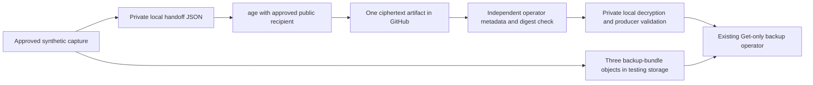

# Recovery handoff custody proposal

Date: 2026-11-01 (America/Toronto). Project: `bobai` / `boisey9/BobAI`.

Status: **owner selected the existing public repository with an encrypted GitHub artifact for local implementation on November 1; publication and activation remain unapproved**. This copy accompanies `codex/backup-custody-encryption`; the original design remains in `codex/backup-custody-design`. Both are based on frozen dormant candidate `efe81de8c61e52136b9a1df061c73c7e3c6bb2d3`. That candidate and its pending feature-push/draft-PR approval remain unchanged. This branch has no additional publication guard and must remain local unless separately prepared and approved.

## Finding and recommendation

The local [handoff](../../Core/scripts/lib/backup-recovery-handoff.mjs) already persists a bounded, exact-byte producer record, and the [download operator](../../Core/scripts/lib/backup-download-input.mjs) already consumes its hash, length and producer binding. The missing hosted capability is retaining and independently reading that record after the ephemeral capture runner disappears. The frozen design baseline did not bind `BOB_BACKUP_TESTING_RECOVERY_DIRECTORY`. The [local encryption successor](2026-11-01-backup-custody-encryption.md) now wires it in this implementation worktree; both workflow source holds remain disabled and hosted acceptance is pending.

Fresh repository metadata returned `boisey9/BobAI`, repository ID `1310270513`, owner ID `6569974`, `private:false`, `visibility:public`, default branch `main`. Therefore artifacts and job logs must not be treated as owner-private merely because the operator signs in. GitHub documents artifact download access for signed-in users with repository read access. No repository visibility was changed. [Repository](https://github.com/boisey9/BobAI), [artifact access documentation](https://docs.github.com/en/actions/how-tos/manage-workflow-runs/download-workflow-artifacts?tool=webui).

**Recommended option for one synthetic hosted drill:** an encrypted recovery-handoff artifact in the existing repository, using the already reviewed public age recipient, plus independent owner readback. The private key stays with the operator. This avoids creating a new memory authority or assuming a new private storage account, but publishing this ciphertext and its minimal public metadata still needs explicit owner approval. If that exposure is unwanted, select a separately controlled private custody destination before implementation; do not make the repository private or create credentials automatically.

This is custody outside the disposable runner and separate from the Neon/S3 backup store. It is not write-once storage, survival of GitHub account/repository loss, independence from a compromised capture job, or the missing off-device Production recovery destination. The source repository, approved workflow and capture job remain trusted. GitHub's artifact toolkit supports deletion; `contents:read` and `overwrite:false` are not proof that the job lacks artifact deletion capability. [Official artifact toolkit](https://github.com/actions/toolkit/blob/main/packages/artifact/README.md).

## Repository visibility and owner-confirmed GitHub plan

On November 1, the owner offered to return BobAI to private visibility and confirmed that the personal account uses **GitHub Free**. The repository metadata still reports public visibility and personal-account ownership. The authenticated profile/CLI reads did not return the subscription plan, so Free is owner-confirmed rather than independently established by the API. No visibility or subscription change has been made or approved.

BobCore, the existing Vercel/Neon architecture and the proposed encryption contract do not require public source. The reviewed testing workflow binds repository, branch, source and runner identities without a public-visibility condition. Local records do not establish why public visibility was originally recommended; do not infer an approved public-source policy from the current setting.

| Choice | Verified plan consequence | Effect on this proposal |
| --- | --- | --- |
| Keep the existing public repository on Free | Branch protections and Actions environments remain available. | Recommended current path while preserving existing protections: encrypted handoff custody and minimal public logs, selected by the owner for local implementation; later upload approval is still required. |
| Make the existing repository private on Free | Protected branches are unavailable. Configured Actions environment protection rules and secrets are ignored. | Does not satisfy the retained requirement to preserve protections. Do not change visibility as a shortcut for artifact privacy. |
| Private personal repository on Pro | Protected branches and basic environments/secrets/deployment-branch controls are supported. Environment required reviewers and wait timers remain public-only on Pro. | A possible later direction, requiring a separately reviewed approval process and verification of connected access and Actions allowances. No subscription change or equivalent-control claim is approved here. |
| Keep source public and select separate private custody | Existing source protections can be retained, but destination access, retention and operator readback remain to be defined. | An unselected alternative; no destination, credential or upload is implicitly authorized. |

These are platform capability limits, not a new inspection of the repository's effective branch/environment settings. GitHub documents the distinctions in [protected-branch availability](https://docs.github.com/en/repositories/configuring-branches-and-merges-in-your-repository/managing-protected-branches/about-protected-branches) and [environment availability and private conversion](https://docs.github.com/en/actions/how-tos/deploy/configure-and-manage-deployments/manage-environments), reviewed November 1. Repository privacy also does not make existing public forks private; see [visibility consequences](https://docs.github.com/en/repositories/managing-your-repositorys-settings-and-features/managing-repository-settings/setting-repository-visibility).

For any later private-source choice, retain handoff encryption, authenticated producer/readback checks, private-key custody and off-device recovery requirements. Verify existing GitHub/Vercel connector access and any independently selected image visibility/pull authentication; repository visibility alone does not establish those capabilities. Keep deployment guards and both literal testing holds unchanged. The owner subsequently selected the existing public repository with an encrypted GitHub artifact for local implementation. That choice does not approve source publication, artifact uploads or a hosted drill.

## Proposed data flow and public boundary

| Item | Proposed treatment |
| --- | --- |
| Handoff JSON | Existing exact version-1 record, at most 4,096 plaintext bytes. Keep its final newline and existing producer/anchor fields. No schema extension is required for storage custody. |
| Recipient | Read only from the independently approved capture binding. Check its fingerprint against the retained handoff. Never choose a recipient from downloaded content or put a private key in CI. |
| Artifact payload | One binary age ciphertext file named `recovery.json.age`; proposed maximum 16 KiB. Reject oversized output instead of silently increasing the limit. This bound is separate from the plaintext bound. |
| Artifact archive | Proposed maximum 64 KiB and exactly one permitted file entry, with a 16 KiB expanded limit. No traversal, absolute paths, links, special files, duplicate entries or extra files. Validate before extraction. |
| Artifact name | `bob-recovery-handoff-r<runId>-a<runAttempt>`, containing only validated decimal identities. Do not add backup UUID, instance, recipient, object keys or user data to the public name. |
| Upload settings | Exact validated ciphertext path; fail if absent; no overwrite or wildcard directory upload; hidden files excluded. Pin and review the action implementation/version before use. No action pin is selected by this design. |
| Retention | Proposed seven days for the initial synthetic drill, subject to verified repository policy and explicit owner approval. Complete and retain independent operator readback during that window. Custody must cover every period in which the corresponding objects are claimed recoverable; before expiry, transfer to approved continuing custody or explicitly close the synthetic recovery window and follow only approved cleanup. This is not the Production backup retention policy. |
| Public logs/outputs | Permit coarse status/error codes and GitHub run/artifact identities needed for reconciliation. Do not log the plaintext handoff, ciphertext download redirect, credentials, private paths or raw child output. |

The existing exporter/workflow output includes backup UUID, archive size and handoff hash. Encrypting the artifact alone does not make those logs private. The implementation must either capture and validate that output privately before emitting the approved minimal public status, or obtain explicit approval for the current metadata exposure. The recommended implementation uses private bounded output capture; no new inference or activity-memory authority is involved.

GitHub's upload action exposes artifact IDs/digests and supports error-on-missing and overwrite controls. Artifacts can expire or be deleted; a stable name is not a permanent object identity. Repository policy can limit the requested retention. These capabilities justify the proposed settings, not a claim of current custody acceptance. [Upload action](https://github.com/actions/upload-artifact), [retention and digest behavior](https://docs.github.com/en/actions/tutorials/store-and-share-data).

## Selected local workflow implementation

1. Preserve both literal false job conditions and the disabled/null binding. Create distinct canonical private directories for adapter inputs, retained plaintext handoff, and ciphertext-only upload staging. The handoff directory must be owned `0700`, outside checkout and disjoint from the adapter temporary tree in both directions. Do not upload a parent directory or reuse a credential-input directory.
2. Supply `BOB_BACKUP_TESTING_RECOVERY_DIRECTORY` explicitly. Use the existing runner and retain its same source/run/attempt/image checks. Intercept child output into a bounded private channel, preserve exit status and cancellation, and validate the exact successful handoff result before selecting a file. Do not rely on a glob or success-looking log line.
3. Validate exactly one retained `<backup-uuid>.recovery.json`, including canonical path, owner, single link, mode `0600`, 4 KiB bound, hash/length and producer/anchor consistency. Encrypt those verified bytes using pinned age and the reviewed public recipient. Use bounded owned-process supervision and private staging; never pass the private key or credentials on a command line.
4. Only a confirmed successful capture/local-retention result can reach the ciphertext upload step. Upload the exact one-file package with a unique run/attempt name. Record artifact ID and returned digest as an upload acknowledgement, not independent readback. Do not use `always()` to upload arbitrary diagnostics after a failure.
5. Keep storage secrets limited to the existing capture step. The uploader must not inherit database/storage secret variables or a recovery private key. Workflow runtime artifact credentials are a distinct capability, even without extra `GITHUB_TOKEN` write permissions. Review the pinned action's supported container runtime and its effective capability before activation.
6. Confirm owned tool shutdown before removing plaintext inputs. Retain uncertain ciphertext/record evidence for the original run where observable. Ephemeral runner disposal is still required after uncatchable termination. No cancellation rule can guarantee delivery after host loss.

The exact local implementation should reuse the current file, producer and process validation contracts. A workflow-directory patch by itself is insufficient. Do not add a general-purpose storage framework, reimplement the backup downloader, or promote producer assertions into proof of GitHub origin.

## Independent operator readback

The operator starts with a separately approved source commit, image digest, repository/owner IDs, workflow identity and expected run/attempt. These values must not be learned solely from the artifact being checked. Existing authorized GitHub access may be used for metadata and artifact readback; do not create a PAT or expand scopes automatically. Fine-grained artifact/run inspection requires Actions read access when authenticated access is needed. [Artifact REST API](https://docs.github.com/en/rest/actions/artifacts), [workflow-run attempt API](https://docs.github.com/en/rest/actions/workflow-runs#get-a-workflow-run-attempt).

The proposed reader must:

1. Fetch the exact run attempt from GitHub and verify repository/owner identity, expected source SHA, main branch, manual dispatch, workflow path, expected attempt, independently approved initiating/rerunning actor identities and terminal successful capture/upload job evidence. Never select “latest successful.” A newer attempt must not replace the intended one.
2. Select the explicit artifact ID and validate its repository/run/head association, unique expected name, nonexpired status, bounded size and SHA-256 digest. The artifact REST object does not establish a separate signed attempt field: compare its association, the named attempt, run-attempt/job evidence, creation interval and the decrypted producer record. Refuse ambiguous evidence; do not call the name alone authenticated provenance.
3. Download through the GitHub-provided temporary redirect with a bounded HTTPS transfer. Never log the signed redirect or forward the GitHub authorization header to the storage host. Reject unexpected redirect behavior and any digest mismatch. Do not interpret successful extraction or an action warning as integrity acceptance; GitHub documents that its automatic digest mismatch reporting can be only a warning.
4. Verify the raw artifact digest before bounded one-entry archive handling. Do not rely on preserved archive modes: create the private destination and output files explicitly. GitHub's ordinary artifact extraction does not preserve `0600` file permissions. [Download action permission behavior](https://github.com/actions/download-artifact#maintaining-file-permissions).
5. Decrypt locally using the independently held key through its existing private file path. Validate the unchanged handoff schema and all producer identities, recipient fingerprint and backup anchor fields; compute the exact plaintext hash/length including newline. Age encryption proves decryptability/integrity for that recipient, not who produced the record. The authenticated GitHub association and approved source establish the separate provenance argument.
6. Write a private custody receipt containing the approved source/image, repository/owner/run/attempt/artifact identities, observed expiry, artifact digest/size, handoff hash/length and readback time. Bind the existing download plan's `handoff` fields to that receipt and use a bounded reference such as `github-artifact:<id>` for `review.custodyReference`. Validate the private plan with the existing operator before any backup-store request.

The artifact API's download URL is short-lived; expired/missing artifacts are explicit refusal states. An owner receipt stored only on the same Mac is useful local evidence but does not close off-device recovery. Archive SHA-256, encrypted-file SHA-256 and plaintext handoff SHA-256 are separate values and must never be substituted for one another. Retain the encrypted-file hash/length with the operator receipt as well. [Artifact metadata/download semantics](https://docs.github.com/en/rest/actions/artifacts#download-an-artifact).

## Failure and acceptance states

| State | Interpretation and recovery |
| --- | --- |
| Capture/ledger verified; local handoff missing | Backup objects may exist, but producer anchors lack accepted custody. Preserve original UUID and investigate; do not launch another capture as a retry. |
| Local handoff verified; upload failed or acknowledgement lost | Custody remains unaccepted. Reconcile the exact run/attempt/name/artifact IDs through approved read access. Never overwrite or delete a possibly completed artifact automatically. Any authorized upload retry must reuse the same retained ciphertext bytes; randomized re-encryption is a new candidate, not an identical retry. |
| Artifact upload acknowledged | Off-runner storage was reported by the producer job. Independent operator readback remains pending. |
| Digest, attempt, producer, recipient or size mismatch | Refuse before the backup store is contacted. Preserve bounded evidence privately; no permissive fallback. |
| Independent readback complete | The exact handoff can authorize the existing Get-only download plan within the approved testing scope. It does not prove backup restoration or service readiness. |
| Run failed after an apparently valid upload | Normal acceptance refuses. An owner-reviewed incident process may reconcile that exact evidence; do not silently promote a partial run to success. |
| Artifact/run/repository expired, deleted or unavailable | Automatic custody readback is unavailable. Use an independently retained approved receipt/record if one exists; never invent anchors from the backup store's own receipt. |

## Acceptance plan and implementation division

**First successor code slice (implemented locally):** private recovery-directory wiring, exact handoff selection/encryption and public-log boundary, all default-off; see the [implementation and validation record](2026-11-01-backup-custody-encryption.md). Tests must use synthetic files and an injected uploader; no real GitHub upload, secret creation or destination selection. Require absence of credential, backup-UUID and private handoff/receipt-hash sentinels from public output (the GitHub artifact/ciphertext digest may be retained as approved public reconciliation evidence), exact recipient and source/run/attempt binding, safe path/mode/size refusal, cancellation and child-shutdown behavior, and refusal before upload on capture/retention failure.

**Second successor code slice:** bounded read-only GitHub custody verification and adaptation into the existing private download plan. Cover wrong repo/owner/source/run/attempt/artifact, duplicate names, expiration/deletion, changed digest, redirects/token isolation, missing digest, malformed/oversized archives, path/link attacks, decryption failure, wrong producer/recipient, exact newline/hash handling, file modes, uncertain output and no backup-store effects before acceptance. Use recorded synthetic API fixtures, not fabricated hosted acceptance.

**One separately authorized hosted drill:** pin the approved upload action; prove actual repository visibility/retention and intended reader access; run the synthetic capture and ciphertext upload; destroy the owned runner; independently retrieve/decrypt/read back that exact artifact; use the accepted handoff to download/restore the same bundle into the approved empty target; record revocation, failure handling and cleanup. Verify the encrypted artifact contains only the handoff and that public logs meet the accepted metadata boundary. No schedule, Production artifact or key upload is included.

The existing public repository with encrypted handoff artifacts is now the selected local design. Retention, permitted public metadata, approved reader authority and actual artifact publication for the bounded hosted drill still require separate review/approval. Source publication approval for `efe81de8…` does not approve any of these. No estimate of billing, effective retention, action compatibility or actual hosted durability is asserted without verification.

## Evidence and local checkpoint

Repository metadata and official artifact/run/action documentation were read during this slice. The authoritative context read at `2026-11-01T18:53:16.167Z`, revision `66a5a09f810e626ea625f78b90876ad0eca8545201bf2362acf846cf43110b79`, matched BobAI UUID `10000000-0000-4000-8000-000000000001`, repository and Codex surface. All five sources were available; events/memories were truncated, `partial:true`, and tasks/handoffs retain their older dates. No proposal was activated or synchronized to BobCore.

The visibility clarification used a fresh context read at `2026-11-01T20:00:01.967Z`, revision `f9dadbc6565f765d83e1141d1f4b9fd5b49eb25192f9e66738de4355fab85caa`, with the same BobAI UUID/repository/Codex identity. All five sources were available; context remains partial, with truncated events/memories and older task/handoff records. The GitHub Free finding and conditional recommendation are retained here as a pending local checkpoint, not an active BobCore decision or synchronized event.

The original design slice changed only this document and the implementation index. Its selected successor is documented in the [local encryption implementation](2026-11-01-backup-custody-encryption.md). Neither slice authorizes publication, uploads, activation, visibility changes, new credentials or a hosted drill. The frozen source-publication candidate and its pending approval remain unchanged; actual independent custody and operational readiness remain unproven.
